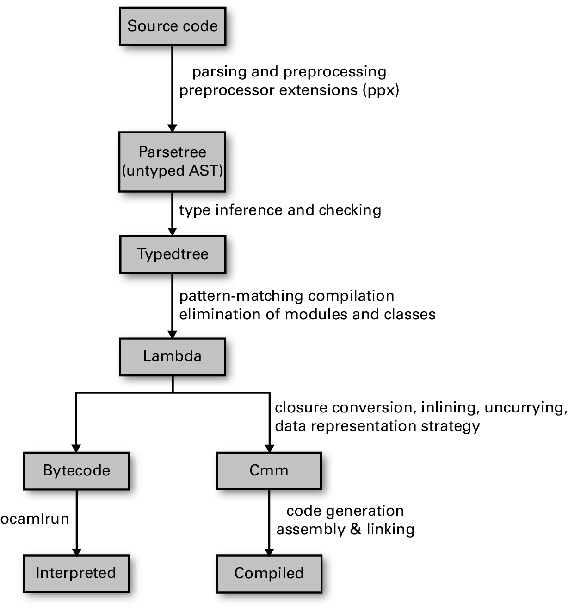

# A Glance of `ppxlib`

The overall pipeline of OCaml compilation. The diagram is from _Real World OCaml_ (_Chapter 25_). 

There is a slightly unclearness in the diagram that a ppx (a ppx deriver or an ppx extender) takes a `Parsetree.Ast` with a ppx attribute (e.g. `[@@deriving z3]`) or a ppx extension hole (e.g. `[%html 
OCaml
]`) and returns a `Parsetree.Ast`.

`Driver.run_as_ppx_rewriter` performs like above

`Driver.standalone` will create an executable.

https://ocaml-ppx.github.io/ppxlib/ppxlib/writing-ppxs.html#the-expand-function

Building and inspecting AST nodes can be painful due to how large the AST type is. ppxlib provides several helper modules to ease this generation, such as Ast_builder, Ppxlib_metaquot, Ast_pattern, and Ast_traverse, which are explained in their own chapters: Generating AST nodes, Destructing AST nodes and Traversing AST nodes.

https://ocaml-ppx.github.io/ppxlib/ppxlib/Astlib/Ast_500/Parsetree/index.html

https://ocaml-ppx.github.io/ppxlib/ppxlib/generating-code.html
https://ocaml-ppx.github.io/ppxlib/ppxlib/matching-code.html
https://ocaml-ppx.github.io/ppxlib/ppxlib/ast-traversal.html

The type is pretty verbose

https://ocaml-ppx.github.io/ppxlib/ppxlib/Astlib/Ast_500/Parsetree/index.html

`Ast_builder` is in ppxlib
`Ast_helper` is legacy in OCaml compiler API

## Location

It's obviously not always (indeed rarely) possible to mint new locations when manipulating the AST.

The intended way to deal with locations is this:

AST nodes that exist in the source should keep their original location
new nodes should be given a "ghost" location (i.e., { some_loc with loc_ghost = true }) to indicate that the node doesn't exist in the sources.
In particular, Location.none is never meant to be used by PPX authors, where some location is always available (for instance, derivers and extenders at least know the locations of their relevant node).

`[%ocaml.error "error_message"]`

`'a Loc` is record with both a payload type `'a` and a `Location.t`.

`Loc.map` maps on `a` but keep `Location.t`.

`Longident` is a dot-separated multi-string e.g. `A.B.C`.

`Location` is a record for location details `{loc_start; loc_end; loc_ghost}`.
